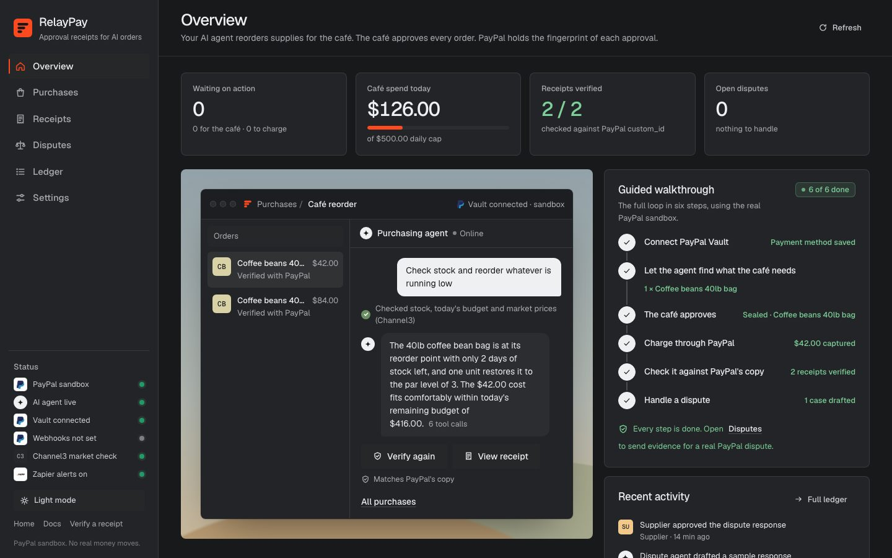
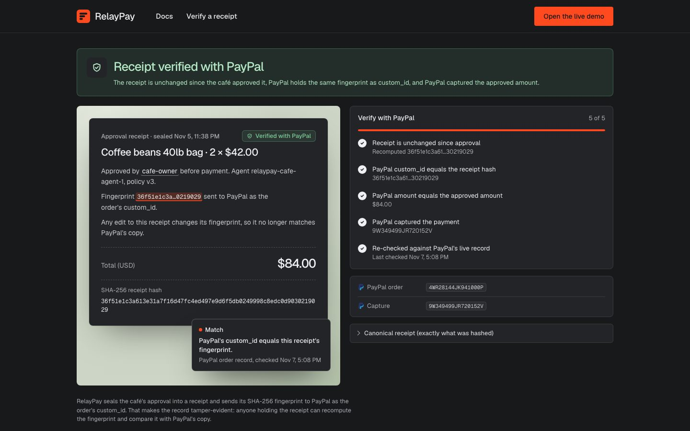

# RelayPay — approval receipts for AI-agent orders

A coffee supplier runs RelayPay to offer an **AI reordering service** to its café customers. The agent watches a
café's stock and proposes the next order. The **café owner approves** it, and that approval is sealed into a
**SHA-256 receipt** whose fingerprint travels with the PayPal payment as `custom_id`, so PayPal holds an independent
copy. If the payment is later disputed ("we never authorized this"), the **supplier** checks the receipt against
PayPal's copy and responds with a tamper-evident record instead of having little to show.

Built for the PayPal AI Hackathon. **PayPal sandbox only; no real money moves.**

| | |
|---|---|
| **Hosted demo** | https://relaypay-h1h0.onrender.com (the console is at `/app`) |
| **Video** | `[paste YouTube URL here]` |
| **Docs** | `/docs` on the hosted demo: the flow, every PayPal call, both agents, verifying a receipt yourself |
| **License** | MIT |



## For judges: try it in two minutes

No PayPal login is needed. The café's PayPal is already saved with Vault on the hosted demo.

1. Open the hosted demo and choose **Open the live demo**.
2. **Purchases → send the request** in the purchasing agent box (orange arrow). The agent calls its tools and proposes an order. If nothing is running low, press **Run a café day** first.
3. On the new proposal, press **Café approves**. The approval is sealed into a receipt (SHA-256).
4. **Charge with PayPal.** A real sandbox order is created and captured, with the receipt's fingerprint as `custom_id`.
5. **Verify with PayPal.** RelayPay re-reads the order from PayPal; open **View receipt** to see the four checks.
6. **Disputes → Run sample.** The dispute agent checks the receipt against PayPal and drafts the response (labelled as a sample; nothing is sent).
7. In the receipt, open **Public verification page** to see what anyone holding the receipt can check.

The free hosting tier sleeps when idle, so the first visit can take about a minute to wake up.

## Testing access

- **No login and no credentials are needed.** The hosted demo uses PayPal's **sandbox** only, and no real money moves. The café's PayPal is already saved with Vault, so **Charge with PayPal** works without a PayPal login.
- Every step in the list above works on the hosted demo. If the agent says nothing is running low, press **Run a café day** first.
- The demo is **shared**: every visitor sees the same café, and the daily spend cap and request limits are shared too (raised on the hosted demo). If you see "Over today's cap" or "reached today's limit", it resets at 00:00 UTC.
- **Disputes → Run sample** is the way to see the dispute agent. Filing a *real* sandbox dispute needs a PayPal sandbox buyer login, which is not shared publicly; the sample runs the same dispute agent on a real captured payment.
- The demo stays live until judging ends on December 15, 2026.

---

## Who is who

| Role | In the story | In the PayPal sandbox |
|---|---|---|
| **Supplier** (merchant) | Runs RelayPay, gets paid, answers disputes | Your sandbox **Business** account (the REST app's credentials) |
| **Café** (customer) | Saves PayPal once, approves each order the agent proposes | Your sandbox **Personal** (buyer) account |
| **AI purchasing agent** | Proposes orders for the café; cannot pay | LLM with tool calls |
| **AI dispute agent** | Checks the receipt against PayPal and drafts the supplier's response | LLM with tool calls |

In the demo, the café's approval happens on the same screen; in production it would be the café's own portal.

## Why this exists

Agents are starting to order on people's behalf. When a payment is disputed as unauthorized, the merchant usually has
little to show: no record of what the agent proposed, who approved it, or whether the approved order is what was
charged. In PayPal's [Agentic Commerce Pulse Report](https://www.paypal.com/us/brc/article/agentic-commerce-pulse-report-findings)
(498 US merchants), almost two-thirds agree a standardized liability framework for AI-initiated purchases is needed.

Dispute tools argue after the fact. RelayPay brings the signed-mandate idea (AP2) to PayPal merchants today and
creates the record **before the purchase**: the café's approval is sealed when it happens and its fingerprint is stored
inside the PayPal payment.

**What the receipt proves, precisely:** it existed when PayPal took the payment and has not changed since, and PayPal
holds an independent copy of its fingerprint. It is a tamper-evident approval record. It does not by itself prove
who clicked approve; that rests on the approval flow that created it.



## The loop

```
1. Stock runs low            "Run a café day" uses up the café's inventory
2. Agent proposes            tool calls: low stock → inventory → budget → (Channel3 market price) → proposal
3. Café approves             price recomputed from the catalog, checks re-run, approval sealed (SHA-256)
4. Supplier charges          Orders v2 + the café's saved Vault token, custom_id = receipt fingerprint
5. Check against PayPal      re-read the order from PayPal, recompute the fingerprint, compare custom_id
6. Payment disputed          webhook or "Check PayPal for new disputes"
7. Dispute agent             dispute → receipt → timeline → PayPal capture → fingerprint check → decision
8. Supplier sends or refunds evidence PDF via provide-evidence, or accept-claim
```

## Screens (six) and public pages

Public pages: `/` (landing), `/docs` (how it works, PayPal APIs, verify a receipt yourself), `/verify` (look up a receipt by hash), `/r/<hash>` (a receipt's checks), `/privacy`, `/terms`.


| Screen | What it's for |
|---|---|
| **Overview** | Today's numbers, a live order window (the agent's latest proposal with its Approve / Charge / Verify buttons), the guided six-step walkthrough, recent activity |
| **Purchases** | Café stock, the agent's proposals with its reasoning, café approval, charge with PayPal |
| **Receipts** | Every sealed receipt from the moment the café approves, its PayPal payment state (not charged, captured), **Charge** or **Verify with PayPal**, CSV (optional **Reconcile with PayPal** when `ENABLE_RECONCILE=true`) |
| **Disputes** | Import or sync PayPal disputes, advance them in the sandbox, the agent's verdict, evidence checks, the response and a preview of the evidence PDF |
| **Ledger** | Who did what and when (agent, café, supplier, PayPal), plus verified PayPal webhooks |
| **Settings** | Read-only status: Vault (locked once connected), approval rules, catalog, connections |

## What is real

| Piece | How it works |
|---|---|
| **Purchasing agent** | Real tool-calling loop over an OpenAI-compatible API. The model picks each tool; the backend runs it. Tools: `get_low_stock_products`, `search_catalog`, `check_inventory`, `check_budget`, `compare_market_prices` (Channel3), `propose_purchase`. JSON-mode tool calling if `tools` is rejected; labelled deterministic fallback without a key. |
| **Dispute agent** | Tools: `get_dispute`, `get_receipt`, `get_event_timeline`, `get_paypal_confirmation` (re-reads the capture from PayPal), `verify_hash`, `decide_case`. A guardrail never recommends contesting unless the fingerprint matches PayPal's own record. |
| **Approval record** | Sealed on the café's approval: product, quantity, amount, rationale, approver, time, agent ID, model, prompt hash, the checks that ran (catalog price, daily limit, extra confirmation over $100), and the Channel3 market check. Fingerprint = SHA-256 of the canonical JSON (fits PayPal's 127-char `custom_id`). |
| **Inventory** | Stock, reorder points and targets persist. A charged order adds its quantity once; "Run a café day" consumes daily usage. |
| **Charge** | `POST /v2/checkout/orders` with `payment_source.paypal.vault_id` and `custom_id`; explicit `/capture` if PayPal returns `APPROVED`; only a `COMPLETED` capture counts. `PayPal-Request-Id` makes create and capture idempotent. |
| **Verification** | Re-reads the order from PayPal and checks: receipt unchanged, `custom_id` equals the fingerprint, amount matches, capture complete. `/r/<hash>` shows the same checks publicly and flags altered receipts. |
| **Dispute record** | PayPal's copy of the fingerprint is always read from PayPal: the dispute's `disputed_transactions[].custom`, else the disputed capture's `custom_id`, else the order. Re-verified against a fresh read before the irreversible submission. |
| **Evidence PDF** | Fingerprint check, Vault consent time, café approval, PayPal's capture confirmation, timeline and response; sanitized, wrapped and paginated. |
| **Webhooks** | Signature verified; unsigned events rejected; capture events checked against amount, currency, `custom_id` and capture ID; dispute drafting runs after PayPal is acknowledged. |
| **Reliability** | Atomic writes (Postgres row lock or a file write queue), database-backed rate limits, in-flight locks on irreversible actions, Vault locked once connected, no secrets in the browser, unit tests. |

## PayPal APIs used

- **Vault v3**: setup tokens, payment tokens (return URL exchanges automatically)
- **Orders v2**: create with `vault_id` + `custom_id`, get, capture
- **Payments v2**: get capture (PayPal's copy of `custom_id`)
- **Disputes v1**: list, show, provide-evidence (PDF), accept-claim, escalate, sandbox require-evidence, sandbox create (`PayPal-Auth-Assertion`)
- **Webhooks**: verify-webhook-signature; `PAYMENT.CAPTURE.COMPLETED`, `CUSTOMER.DISPUTE.CREATED/UPDATED/RESOLVED`
- **Transaction Search**: reconciliation (counts only)

The agents never hold PayPal credentials and never move money. Live PayPal is refused unless `ALLOW_LIVE=true`.

## AI

`subconscious/glm-5.3-marathon` via `https://api.subconscious.dev/v1` (OpenAI-compatible; change with `LLM_BASE_URL` /
`LLM_MODEL`). Two agents with visible tool traces; the purchase prompt's hash is sealed into each receipt.

### AI tools and services used

The hackathon asks every entry to name each AI tool, model or service it used, and how. In the running product:

| Tool or service | How it is used |
|---|---|
| `subconscious/glm-5.3-marathon` (via `LLM_BASE_URL`) | Both agents run a tool-calling loop on it. The model chooses which tool to call; the backend runs the tool and enforces every rule. It also writes the supplier's dispute response from facts the tools returned. |
| Channel3 API | The purchasing agent's optional market price check. |
| No other model | Receipt hashing, price math, policy checks and PayPal verification are deterministic code, not AI. |

Development tools: Claude Code (Anthropic) was used by Pratham Rathod during the hackathon to review the codebase, write the test suite and CI, fix bugs found in testing (including the Postgres receipt-hash fix), and write documentation. **[Mayur: add any AI coding assistants you used to build RelayPay's first version, and what for. The rules require every AI tool to be named.]**

## Partners and integrations

| Integration | Use | Turn on |
|---|---|---|
| **AG Grid** (Community 32) | Receipts, ledger and webhook tables: quick filter, CSV export, external actor filter, custom renderers, pinned actions, auto-height rows, pagination | always on |
| **Render** | Blueprint with a web service | deploy |
| **Channel3** | Market price check sealed into the receipt | `CHANNEL3_API_KEY` |
| **Owner alerts** (optional) | A Discord, Slack or ntfy.sh message when the café's approval is needed, an order is charged, a dispute arrives, evidence is sent | `ALERT_WEBHOOK_URL` |

---

## Run it locally (about 5 minutes)

Requires Node 20+. No database or webhook needed locally.

1. `git clone https://github.com/mayurbijarniya/relaypay.git && cd relaypay`
2. `cp .env.example .env` and fill in `PAYPAL_CLIENT_ID`, `PAYPAL_CLIENT_SECRET` (sandbox), `LLM_API_KEY` and
   `NEXT_PUBLIC_BASE_URL=http://localhost:3000`. The sandbox app needs **Save payment methods** (Vault) enabled.
3. `npm install` then `npm run dev` → http://localhost:3000 (landing page) and http://localhost:3000/app (the console)
4. Follow the **guided walkthrough** on Overview:
   - **Settings → Create approval link → Open PayPal approval**, log in as the café (sandbox Personal account), approve.
   - **Purchases → Ask the agent to restock → Café approves · seal receipt → Charge with PayPal**
   - **Receipts → Verify**
   - **Disputes → Run sample** (a labelled sample; nothing is sent)

Scripts: `npm run check` (types + tests), `npm test` (unit and route tests against a fake PayPal and LLM: no network, no credentials), `npm run seed` (spare charged orders), `npm run reset` (wipe local data).

### A real sandbox dispute (for the video)

1. `npm run seed` for spare charges; evidence can only be submitted once.
2. Log in to sandbox.paypal.com as the **café** (buyer), open a RelayPay payment, **Report a problem**.
3. RelayPay → **Disputes → Check PayPal for new disputes** (or wait for the webhook) → **Advance in sandbox** until
   PayPal is waiting for evidence → **Approve this response → Send evidence to PayPal**. Record it the first time.

## Deploy on Render

1. Push the `relaypay/` folder as the repository root, then Render → **New → Blueprint**.
2. Set `DATABASE_URL` (Neon recommended: Render's free Postgres expires after about 30 days, which would fall inside
   judging), `PAYPAL_CLIENT_ID`, `PAYPAL_CLIENT_SECRET`, `LLM_API_KEY`, `NEXT_PUBLIC_BASE_URL`, and optionally
   `CHANNEL3_API_KEY`, `ALERT_WEBHOOK_URL`, `SANDBOX_BUYER_EMAIL`.
3. Register `https://<your-app>/api/webhooks/paypal` in the PayPal dashboard for `PAYMENT.CAPTURE.COMPLETED` and
   `CUSTOMER.DISPUTE.*`; set its ID as `PAYPAL_WEBHOOK_ID`.
4. Connect Vault once (Settings, as the café). It's then locked, and judges can charge orders without logging in.
5. Point a free uptime monitor at `https://<your-app>/api/health` (see **Operating the live demo**).

## Environment variables

| Variable | Needed | Purpose |
|---|---|---|
| `PAYPAL_CLIENT_ID`, `PAYPAL_CLIENT_SECRET` | yes | Sandbox REST app (the supplier) |
| `PAYPAL_ENVIRONMENT` | yes | `sandbox` (live refused unless `ALLOW_LIVE=true`) |
| `LLM_API_KEY` | for the live agent | OpenAI-compatible key; labelled fallback without it |
| `LLM_BASE_URL`, `LLM_MODEL` | no | Default subconscious.dev / `subconscious/glm-5.3-marathon` |
| `NEXT_PUBLIC_BASE_URL` | yes | Vault return URL and notification links |
| `DATABASE_URL` | when deployed | Postgres; local default is `data/db.json` |
| `PAYPAL_WEBHOOK_ID` | when deployed | Webhook signature verification |
| `SANDBOX_BUYER_EMAIL` | no | Open sandbox disputes from RelayPay (email only, never a password) |
| `CHANNEL3_API_KEY` | no | Market price check |
| `ALERT_WEBHOOK_URL` | no | Owner alerts: a Discord webhook, Slack incoming webhook or `https://ntfy.sh/<topic>` URL (a Zapier Catch Hook in `ZAPIER_WEBHOOK_URL` still works) |
| `ALLOW_VAULT_RESET` | no | Allow reconnecting Vault after it's locked |
| `ADMIN_RESET_TOKEN` | no | 12+ characters. Turns on the team-only **Reset the demo** control in Settings; leave unset to keep it off |
| `ALLOW_SIMULATOR` | no | Accept unsigned simulator webhooks (keep `false` when public) |
| `DISABLE_RATE_LIMITS` | no | Local development only |
| `DAILY_CAP_USD` | no | The café's daily spend limit in USD (default 500). Raised on the hosted demo. |
| `RATE_LIMIT_MULTIPLIER` | no | Scales every rate limit (default 1) |
| `PAYPAL_TIMEOUT_MS` | no | Timeout for each PayPal request (default 20000; evidence uploads 45000) |
| `ENABLE_RECONCILE` | no | Show **Reconcile with PayPal**. Needs "Transaction search" enabled on the PayPal app. |
| `ALLOW_LIVE` | no | Safety switch for live PayPal |

## Code map

```
public/index.html, public/assets/ landing page at / (static, served by a rewrite)
app/app/page.tsx, app/globals.css  the console at /app, theme (dark default + light)
app/r/[hash]/page.tsx              public receipt verification
app/docs, app/verify,              docs, receipt lookup, privacy, terms, 404
  app/privacy, app/terms           (components/PublicShell.tsx: shared header and footer)
app/api/                           intents, orders, disputes, inventory, vault, webhooks, notify, ledger
components/useRelayPay.ts          data, polling, every action
components/views/                  the six screens
components/kit.tsx                 the landing page's UI pieces in React (window, chat, checklist, receipt document)
lib/agents.ts                      both tool-calling agents
lib/policy.ts, lib/receipts.ts     catalog, inventory and approval checks; canonical receipt + SHA-256 (unit tested)
lib/disputeService.ts              dispute pipeline (draft, webhook, sync, sandbox create)
lib/store.ts                       Postgres or file storage with atomic writes
lib/channel3.ts, lib/notify.ts     market price check, owner alerts
lib/paypal/                        client, orders, vault, disputes, reporting
tests/, scripts/                   node:test suites; seed and reset
docs/                              README screenshots
```

## Operating the live demo

For the team, while judges are using it (through December 15):

- **Keep it awake.** Point a free uptime monitor at `https://<your-app>/api/health` every 5 minutes. It is cheap and touches nothing. `/api/health?deep=1` also confirms the database answers.
- **Give judges headroom.** `render.yaml` raises `DAILY_CAP_USD` and `RATE_LIMIT_MULTIPLIER` for the hosted demo. The cap in force when a receipt is approved is sealed into that receipt. Raise them further if anyone reports "Over today's cap".
- **Reset to a clean demo, from the app.** Set `ADMIN_RESET_TOKEN` on the server (12 or more random characters, kept secret by the team). Settings then shows **Reset the demo (team only)**: enter the code and everything but the saved PayPal is cleared and starting stock is restored. Without the variable the button and the route are off.
- **Reset to a clean demo from the database** (same result, works even if the app is down). Run in the database console:

  ```sql
  UPDATE relaypay_store
  SET value = jsonb_build_object(
    'intents', '[]'::jsonb, 'orders', '[]'::jsonb, 'events', '[]'::jsonb,
    'disputes', '[]'::jsonb, 'ledger', '[]'::jsonb, 'rateLimits', '[]'::jsonb,
    'vault', value->'vault',
    'inventory', '{"Coffee beans 40lb bag":1,"Coffee beans 5lb bag":5,"Oat milk case (12)":6,"Sugar 10lb bag":4}'::jsonb
  ), updated_at = now()
  WHERE key = 'db';
  ```

- **If charging breaks because the saved PayPal stopped working:** set `ALLOW_VAULT_RESET=true`, redeploy, reconnect Vault in Settings as the café, then set it back to `false`.
- **Spare payments for the dispute video:** `BASE_URL=https://<your-app> npm run seed` creates charged orders. Evidence can be submitted only once per dispute.
- **Before December 1:** run the whole loop on the live URL, check `/api/health?deep=1`, confirm the LLM and Channel3 keys still have credit, and check the webhook shows as delivered in the PayPal dashboard.

## Limitations

- Sandbox only. No login: anyone with the URL can act as both café and supplier, which suits a demo, not production.
- The receipt is tamper-evident, not a signature: it shows the record existed at payment time and is unchanged.
- Evidence submission is one-shot. Creating a dispute from RelayPay needs PayPal's dispute-create permission; the buyer-account route always works.
- Transaction Search indexes payments with a delay of up to a few hours.
- Owner alerts are optional: without `ALERT_WEBHOOK_URL`, RelayPay works the same and simply sends no alerts.

## License

MIT — see [LICENSE](LICENSE).
